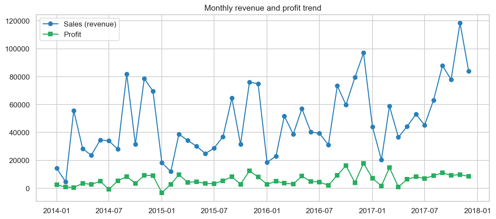
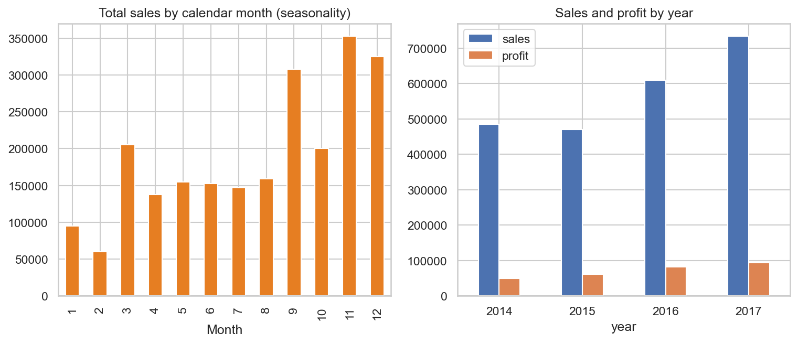
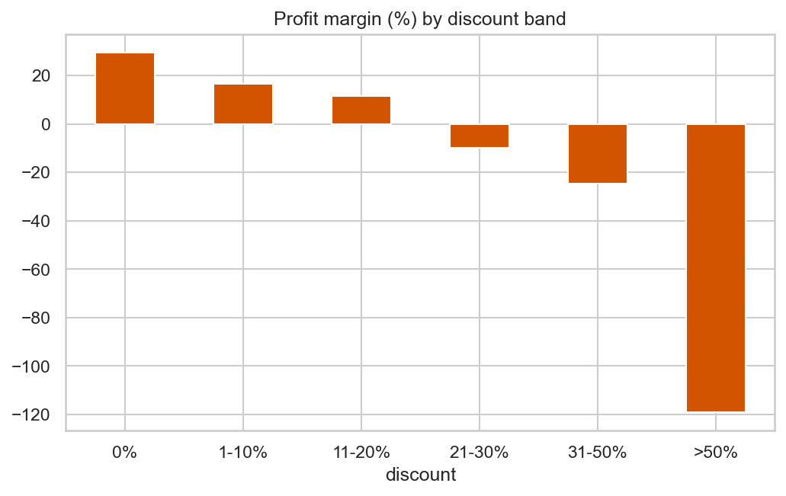

# Sales Data Analysis (Superstore)

> Synent Technologies Data Science Internship | Task 5 (Intermediate level) | Author: Hassan Butt

## Problem statement
Analyse business performance: monthly revenue trends, top-selling products and profit drivers.

## Dataset details
- **Dataset:** Superstore Sales dataset
- **Source:** https://www.kaggle.com/datasets/vivek468/superstore-dataset-final
- **Size used:** 9,994 rows x 21 columns

## Approach
1. Monthly revenue and profit trends with seasonality
2. Top 10 products by revenue and quantity
3. Profit analysis by category, sub-category and region, including loss-making groups
4. Impact of discounts on profit margin
5. Auto-generated business insights report

## Results
| Metric | Value |
|---|---|
| Total revenue | $2,297,201 |
| Total profit | $286,397 |
| Profit margin | 12.5% |
| Best month | Nov 2017 |
| Top product | Canon imageCLASS 2200 Advanced Copier |

**Key insights**

- Total revenue was $2,297,201 with $286,397 profit (margin 12.5%).
- Revenue peaked in November 2017 and was lowest in February 2014; calendar month 11 is the strongest overall.
- The top product by revenue is 'Canon imageCLASS 2200 Advanced Copier' ($61,600).
- Loss-making sub-categories: Tables, Bookcases, Supplies. The most profitable sub-category is Copiers.
- Profit margins fall as discounts rise: 29.5% with no discount vs -119.2% in the highest discount band.

**Figures**







**Other output files:** `business_insights_report.md`

## How to run
```bash
pip install -r requirements.txt
python main.py
```

## Project structure
```
main.py            # full analysis / pipeline
requirements.txt
data/              # dataset (see data/README.md)
outputs/           # figures, tables and reports
```

## Academic integrity
All analysis code and write-ups in this repository were written by the author. The dataset belongs to its original creators (see link above).
