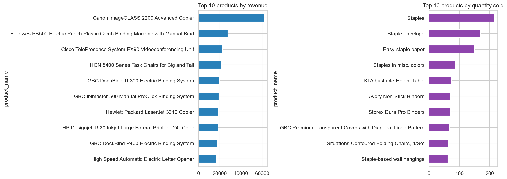
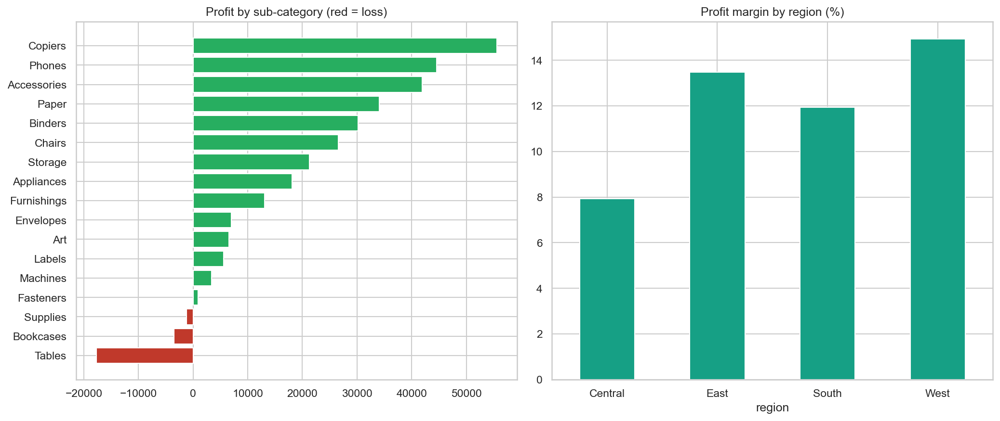

<p align="center"></p>
<p align="center"><a href="https://github.com/khnbutt118-dev">← PROFILE</a> &nbsp;·&nbsp; <a href="https://hassanbuttportfolio.vercel.app/">PORTFOLIO</a> &nbsp;·&nbsp; <a href="https://www.linkedin.com/in/hassan-butt-ab0036334/">LINKEDIN</a></p>

<p align="center"></p>

# 💹 Superstore · Sales & Profit Intelligence
**A business-performance analysis of revenue, product trends, discounting and profitability.**

<table><tr><td align="center"><h2>$2.30M</h2><sub>Total revenue</sub></td><td align="center"><h2>$286.4K</h2><sub>Total profit</sub></td><td align="center"><h2>12.5%</h2><sub>Profit margin</sub></td><td align="center"><h2>9,994</h2><sub>Rows analysed</sub></td></tr></table>

## 📊 Visual report

<p align="center"></p>
<p align="center"></p>
<p align="center"></p>
<p align="center"></p>

## 🔎 Business highlights
| Indicator | Finding |
|:--|:--|
| Strongest month | **November 2017** |
| Top product by revenue | Canon imageCLASS 2200 Advanced Copier · **$61,600** |
| Most profitable sub-category | Copiers |
| Loss-making sub-categories | Tables, Bookcases, Supplies |
| Discount signal | Margin falls from **29.5%** with no discount to **−119.2%** in the highest discount band |

## 🧭 Analysis workflow
`Monthly trends` → `Product ranking` → `Category & regional profit` → `Discount impact` → `Business insights report`

## ▶️ Reproduce
```bash
pip install -r requirements.txt
python main.py
```

<details><summary><b>Dataset & deliverables</b></summary>

- Dataset: [Superstore Sales](https://www.kaggle.com/datasets/vivek468/superstore-dataset-final)
- Data used: 9,994 rows × 21 columns
- Report: `business_insights_report.md`
- Figures and analysis outputs: `outputs/`

</details>
<p align="center"><sub>Python · Pandas · Data visualisation · Business analytics</sub></p>
